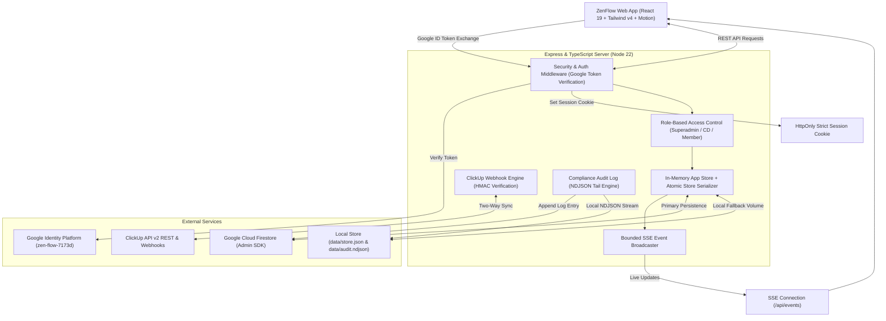

# zenFlow | Intelligent Workload Management System

[](https://nodejs.org/)
[](https://react.dev/)
[](https://www.typescriptlang.org/)
[](https://tailwindcss.com/)
[](https://firebase.google.com/)
[](https://clickup.com/)

**zenFlow** is an institutional-grade, real-time workload orchestration platform engineered for high-velocity creative, content, and design agencies. It balances individual cognitive loads, enforces Work-In-Progress (WIP) limits, provides universal cross-board task delegation, and synchronizes bidirectionally with ClickUp while maintaining strict zero-trust security and compliance auditability.

---

## 📑 Table of Contents

- [Core Capabilities](#-core-capabilities)
- [System Architecture](#-system-architecture)
- [Technology Stack](#-technology-stack)
- [Directory Structure](#-directory-structure)
- [Getting Started](#-getting-started)
  - [Prerequisites](#prerequisites)
  - [Installation](#installation)
  - [Environment Configuration](#environment-configuration)
  - [Running the Development Server](#running-the-development-server)
- [Available Scripts](#-available-scripts)
- [Security & Access Control](#-security--access-control)
- [ClickUp Two-Way Synchronization](#-clickup-two-way-synchronization)
- [Data Persistence & Storage Modes](#-data-persistence--storage-modes)
- [Testing & Quality Assurance](#-testing--quality-assurance)
- [Production Deployment](#-production-deployment)
- [Audit & Compliance Trail](#-audit--compliance-trail)

---

## ⚡ Core Capabilities

### 1. Cognitive Load & Workload Scoring

- **Dynamic Load Scoring**: Tasks are weighted by cognitive strain (`Low = 1`, `Medium = 2`, `High = 3`), dynamically calculating active workload pressure per team member.
- **WIP Limits & Demand Alarms**: Configurable Work-In-Progress thresholds flag overloaded members with immediate visual warnings and demand alerts before task assignments breach capacity.
- **Billable Hours & Cycle Metrics**: Active time accumulation while tasks reside in `in_progress`, alongside manual time adjustments, cycle tracking, and historical activity trails.

### 2. Multi-Stage Swimlane Lifecycle

ZenFlow partitions workflows into dedicated swimlanes for Content and Design boards:

- **Pipeline**: Backlog ideation space for uncommitted initiatives. ClickUp list assignment and deadlines remain optional; tasks do not trigger unassigned warnings.
- **Retainer**: Dedicated lane for ongoing, recurring, or retainer client engagements. Retainer tasks do not require deadlines, do not inflate WIP counts, and feature direct one-click `+ Subtask` generation that feeds actionable items into execution lanes.
- **To Do**: Prioritized queue ready for immediate execution.
- **In Progress**: Active execution lane with live billable duration tracking.
- **In Review**: Creative Director and client review staging.
- **Done & Archived**: Completed milestones with timestamped cycle analytics.

### 3. Floating Cross-Board Free Pool

- **Idle Capacity Detection**: A persistent glassmorphic floating pill continuously monitors all Content and Design team members, identifying individuals with zero active tasks in `To Do` or `In Progress`.
- **Instant Allocation**: Expand the floating panel to review idle members across roles and instantly allocate tasks without leaving the active board view.

### 4. ClickUp Deep Bi-Directional Integration

- **Universal Subtask Delegation**: Any authenticated team member can delegate subtasks across boards. Subtasks nest hierarchically under the parent task in both ZenFlow and ClickUp.
- **Isolated Per-Task Hierarchy**: Dynamic resolution of ClickUp Spaces, Folders, Lists, and Custom Task Types without cross-space UI pollution.
- **Single Source of Truth (SSoT)**: ZenFlow asserts authoritative state on ownership, status, and deadlines, defensively correcting divergence from ClickUp webhooks.
- **HMAC SHA-256 Webhooks**: Raw request signature verification prevents spoofing or tampering of incoming status and assignee updates.
- **Credential Redaction**: Personal API tokens are isolated server-side; client browser payloads receive only non-sensitive connection indicators (`clickupConnected: true`).

### 5. Resilient Real-Time Engine & Offline Capability

- **Server-Sent Events (SSE)**: Bounded output streaming (256 KiB backpressure limit) ensures low latency and memory safety under multi-client loads.
- **Optimistic UI with FIFO Replay**: Offline changes, reorders, and creations are applied instantly to local state and replayed sequentially upon network reconnection.

---

## 🏗 System Architecture



---

## 🛠 Technology Stack

| Layer | Technologies |
| :--- | :--- |
| **Frontend Framework** | [React 19](https://react.dev/) + [TypeScript](https://www.typescriptlang.org/) |
| **Build & Tooling** | [Vite 6](https://vitejs.dev/) + [esbuild](https://esbuild.github.io/) |
| **Styling & Animation** | [Tailwind CSS v4](https://tailwindcss.com/) + [Motion (Framer Motion v12)](https://motion.dev/) |
| **Icons & UI** | [Lucide React](https://lucide.dev/) |
| **Backend Server** | [Express 4](https://expressjs.com/) on [Node.js >= 22](https://nodejs.org/) (ES Modules & `tsx`) |
| **Database & Cloud Storage** | [Firebase Admin SDK](https://firebase.google.com/docs/admin/setup) + [@google-cloud/firestore](https://cloud.google.com/firestore) |
| **Authentication** | Google Identity Platform (`zen-flow-7173d`) via Firebase Auth + HttpOnly Session Cookies |
| **External Integration** | [ClickUp API v2](https://clickup.com/api) with HMAC SHA-256 Webhook Verification |
| **Testing** | Node.js Test Runner (`node --test`), `@firebase/rules-unit-testing`, Firebase Emulators |
| **Deployment** | Docker (Multi-stage build), Railway, Nixpacks, Procfile |

---

## 📂 Directory Structure

```text
c:/ZenFlow/
├── .github/workflows/          # CI/CD workflows (Node 22 / Java 21)
├── data/                       # Local volume data (store.json, audit.ndjson, webhooks.json)
├── docs/
│   └── READINESS.md            # Enterprise readiness & deployment verification guide
├── public/                     # Static assets & favicons
├── server/
│   ├── resources.ts            # Audit tail reader & bounded SSE transport
│   ├── security.ts             # Auth middleware, cookie issuance & payload redaction
│   └── webhooks.ts            # ClickUp webhook HMAC registry & signature validator
├── src/
│   ├── components/             # Reusable UI components & modals (Swimlanes, FreePool, etc.)
│   ├── context/                # DashboardContext (state management, ClickUp sync, offline queue)
│   ├── lib/                    # Firebase client initialization & session management
│   ├── utils/                  # Workload calculations, date formatting & audit helpers
│   ├── App.tsx                 # Main application layout & swimlane orchestrator
│   ├── index.css               # Design tokens & Tailwind theme definitions
│   ├── main.tsx                # React DOM entry point
│   └── types.ts                # TypeScript interfaces (User, Task, AuditLog, ClickUp)
├── tests/
│   ├── benchmark-audit.ts      # Synthetic benchmark for asynchronous audit log reading
│   ├── client-session.test.ts  # Client session migration & token race tests
│   ├── firestore.emulator.ts   # Firestore Security Rules unit test suite
│   ├── fixtures.ts             # Mock server, store & identity fixtures
│   ├── resources.test.ts       # SSE backpressure & audit tail unit tests
│   ├── security.test.ts        # Comprehensive RBAC & webhook verification tests
│   └── smoke-production.ts     # Compiled server artifact production smoke test
├── Dockerfile                  # Multi-stage container definition
├── firestore.rules             # Server-owned Firestore security rules
├── package.json                # Project dependencies and script declarations
├── server.ts                   # Central Express application and ClickUp sync engine
└── vite.config.ts              # Vite frontend configuration
```

---

## 🚀 Getting Started

### Prerequisites

- **Node.js**: `v22.0.0` or higher
- **npm**: `v10.0.0` or higher
- **Java**: JRE 21+ *(optional, required only for running local Firestore Emulator tests)*
- **Google Cloud / Firebase Project**: Dedicated Firebase project for Firestore storage (Google Identity uses `zen-flow-7173d`)
- **ClickUp Account**: Personal or Workspace API token with admin/member access for two-way synchronization

### Installation

1. **Clone the repository**:

   ```sh
   git clone https://github.com/schultz911/ZenFlow.git
   cd ZenFlow
   ```

2. **Install dependencies**:

   ```sh
   npm ci
   ```

### Environment Configuration

Create a `.env` file in the project root:

```sh
cp .env.example .env
```

Populate the configuration values:

```env
# Application URL where the app is hosted (e.g. http://localhost:3000)
APP_URL=http://localhost:3000

# Server Port and Node Environment
PORT=3000
NODE_ENV=development

# Firebase Service Account Key (JSON string, base64-encoded string, or path to serviceAccountKey.json)
FIREBASE_SERVICE_ACCOUNT_KEY=

# Optional local persistent storage directory (defaults to ./data)
ZENFLOW_DATA_DIR=./data
```

### Running the Development Server

Start the full-stack server (serves the Vite frontend and the Express backend concurrently):

```sh
npm run dev
```

Visit [http://localhost:3000](http://localhost:3000) in your browser.

---

## 📜 Available Scripts

| Command | Action |
| :--- | :--- |
| `npm run dev` | Starts the server in development mode using `tsx server.ts`. |
| `npm run build` | Compiles the Vite frontend to `dist/` and bundles `server.ts` into `dist/server.cjs` via `esbuild`. |
| `npm run start` | Runs the compiled production server (`node dist/server.cjs`). |
| `npm run lint` | Runs TypeScript compiler checks without emitting files (`tsc --noEmit`). |
| `npm test` | Runs the complete Node.js test suite across security, sessions, and resources. |
| `npm run test:rules` | Executes Firestore Security Rules unit tests against the local Firebase Emulator. |
| `npm run clean` | Cleans build artifacts (`dist/` and temporary server outputs). |

---

## 🔐 Security & Access Control

ZenFlow adopts a **Zero-Trust, Server-Owned** security posture:

```text
+--------------------------------------------------------------------------+
|                            RBAC Role Hierarchy                           |
+--------------------------------------------------------------------------+
|  Superadmin (kiran.s@zensciences.com)                                    |
|   ├── Full system administration, member provisioning & CD assignment   |
|   ├── Firebase credential management & database status inspection        |
|   └── ClickUp Webhook HMAC registration & compliance audit downloads     |
|                                                                          |
|  Creative Director (CD)                                                  |
|   ├── Board oversight for assigned team (Content / Design)               |
|   └── Task review, workload balancing & team member task management      |
|                                                                          |
|  Team Member                                                             |
|   ├── Universal cross-board subtask delegation to any peer               |
|   ├── Personal task creation, status updates & billable adjustments      |
|   └── Personal ClickUp token connection management (server-redacted)     |
+--------------------------------------------------------------------------+
```

### Key Security Safeguards

1. **HttpOnly Cookie Sessions**: Verified Google ID tokens are exchanged for an `HttpOnly`, `SameSite=Strict` session cookie scoped strictly to `/api`. Tokens are never exposed in URLs or client-accessible web storage.
2. **CSRF & Same-Origin Mutation Protection**: All state-modifying requests require custom headers validated against the application origin.
3. **Firestore Security Rules**: Direct client reads and writes are denied unconditionally (`allow read, write: if false;`). Data is manipulated exclusively by the backend via the Firebase Admin SDK through IAM credentials.
4. **ClickUp Secret Isolation**: Member API tokens are stored securely on the backend and are stripped from all broadcast and response payloads (`clickupConnected` boolean allowlist).

---

## 🔄 ClickUp Two-Way Synchronization

ZenFlow acts as the **authoritative single source of truth** when coordinating with ClickUp:

```text
   ZenFlow Mutation ──────► POST/PUT ClickUp API v2 ──────► ClickUp Task Updated
          ▲                                                         │
          │                                                         ▼
ZenFlow Re-Asserts SSoT ◄─── HMAC Verified Webhook ◄──────── ClickUp Webhook
  (if diverged)              (taskStatusUpdated, etc.)
```

1. **Task Creation & Updates**: Modifying a task in ZenFlow immediately pushes updates (status, assignees, due dates, custom field mappings) to ClickUp.
2. **Assignee Replacement**: ZenFlow computes exact assignee diffs (`{ add: [...], rem: [...] }`) to prevent task reassignment bouncebacks.
3. **Webhook Verification**: All incoming webhooks sent to `/api/clickup/webhook` are cryptographically verified against the private HMAC secret before processing.
4. **Self-Healing Subtask Placement**: If a subtask creation receives ClickUp code `ITEM_137` ("Parent not child of list"), ZenFlow queries the parent task dynamically, resolves the current list ID, and retries placement transparently.

---

## 💾 Data Persistence & Storage Modes

ZenFlow operates under two coordinated persistence tiers:

1. **Cloud Persistence (Primary)**:
   - Powered by Firebase Admin and `@google-cloud/firestore`.
   - Collections: `users`, `tasks`, `compliance_audit_logs`, and private `server_secrets/clickup_webhooks`.
   - Active whenever `FIREBASE_SERVICE_ACCOUNT_KEY` is supplied in the environment or uploaded by Superadmin.
2. **Local Volume Fallback**:
   - Persisted as structured JSON in `data/store.json` and append-only NDJSON in `data/audit.ndjson`.
   - Guaranteed atomic writes using temporary swap files (`.tmp`) to eliminate corruption during sudden process restarts.

---

## 🧪 Testing & Quality Assurance

The test suite exercises real extracted handlers behind live authorization middleware without accessing production services:

```sh
# 1. Run all unit and security integration tests
npm test

# 2. Run Firestore Security Rules emulator tests (requires Java 21)
npm run test:rules

# 3. Perform static analysis and TypeScript verification
npm run lint
npx tsc --noEmit --noUnusedLocals --noUnusedParameters

# 4. Run the synthetic audit tail performance benchmark
node --expose-gc --import tsx tests/benchmark-audit.ts
```

---

## 🚢 Production Deployment

### Docker Deployment

ZenFlow includes a multi-stage `Dockerfile` optimized for minimal attack surface and resource efficiency:

```sh
# Build the production container image
docker build -t zenflow:latest .

# Run container with persistent local storage and environment credentials
docker run -d \
  -p 3000:3000 \
  -e PORT=3000 \
  -e NODE_ENV=production \
  -e FIREBASE_SERVICE_ACCOUNT_KEY="<SERVICE_ACCOUNT_KEY_JSON>" \
  -v zenflow_data:/app/data \
  --name zenflow zenflow:latest
```

### Cloud Platforms (Railway / Nixpacks / Cloud Run)

ZenFlow provides pre-configured [`railway.json`](railway.json), [`nixpacks.toml`](nixpacks.toml), and [`Procfile`](Procfile) manifests for deployment. Ensure the following steps are performed:

1. Provide `FIREBASE_SERVICE_ACCOUNT_KEY` in platform environment variables.
2. Mount a persistent volume to `/app/data` (or specify `ZENFLOW_DATA_DIR`).
3. Deploy frontend and backend together.
4. Deploy Firestore security rules via `npx firebase deploy --only firestore:rules --project <YOUR_STORAGE_PROJECT>`.
5. Access the **Connections & Compliance** modal as Superadmin to register the ClickUp HMAC webhook.

For a detailed deployment runbook, refer to [`docs/READINESS.md`](docs/READINESS.md).

---

## 📜 Audit & Compliance Trail

All critical system actions (task creations, edits, status transitions, user updates, credential modifications, and webhook deliveries) are recorded to an append-only compliance log:

- **Streaming NDJSON**: Stored in `data/audit.ndjson` and mirrored to Firestore `compliance_audit_logs`.
- **Tail-Optimized Reads**: Backend reverse-reads recent log entries in 64 KiB blocks, providing fast initial log hydration without loading multi-megabyte audit histories into memory.
- **Exportable Compliance Logs**: Superadmins can stream and download complete compliance records via `/api/audit/download`.

---

## 📄 License & Attribution

Designed and maintained for ZenSciences. All rights reserved.
